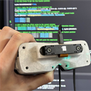
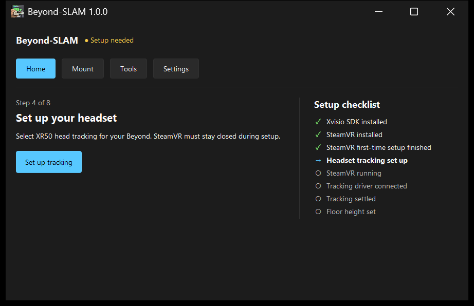
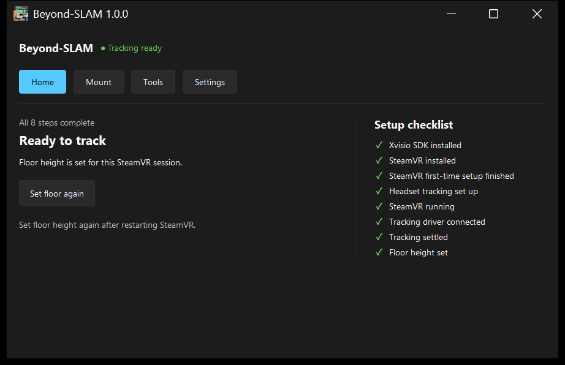

<p align="center">
  
</p>

<h1 align="center">Beyond-SLAM</h1>

<p align="center">
  <strong>SLAM Tracked Bigscreen Beyond</strong>
</p>

<p align="center">
  
  
  
</p>

---

Beyond-SLAM lets a **Bigscreen Beyond** track itself with an **Xvisio XR50** SLAM camera, so the Lighthouse base stations can stay in their box.

It comes with a SteamVR driver and a desktop app that sets everything up for you.

<p align="center">
  
  
</p>

## What you need

- A Bigscreen Beyond
- An Xvisio XR50 ([buy one at Mouser](https://www.mouser.com/en/ProductDetail/Xvisio/XR50?qs=T%252BzbugeAwjjZam0seb3s1Q%3D%3D) [Or Electromaker (better for international)](https://www.electromaker.io/shop/product/small-form-factor-6dof-sensor)) 
- A USB-C to Micro-USB cable ([recommended](https://link.amazon/B0aq5lDhA), [alternative](https://link.amazon/B0aeJE4tO)). 0.65 ft is the shortest that works; 0.6 ft is too short.
- A Windows 10/11 64-bit PC with SteamVR
- The mount below (or your own)

## The mount

The mount is a shell that holds the XR50 on the Beyond. Download [`mount/bsb-slam-shell.step`](mount/bsb-slam-shell.step), 3D print it, and attach the XR50.

No printer? Upload the STEP file to [JLCPCB 3D printing](https://jlcpcb.com/3d-printing) and order it in MJF (Multi Jet Fusion) nylon.

The app includes a matching mount profile, so you can apply the offsets with one click. If you design your own mount, you can enter its offsets by hand on the **Mount** page.

## Get started

1. Install SteamVR and open it once, then close it.
2. Download `Beyond-SLAM-Setup.exe` from [Releases](https://github.com/prohurtz/BSB-SLAM/releases) and run it.
3. Plug in the Beyond and the XR50, then open **Beyond-SLAM Control**.
4. Follow the steps on **Home**.

The app also checks GitHub for updates and installs them for you.

## Back to base stations

1. Close SteamVR.
2. Choose **Tools → Troubleshooting → Use base stations**.
3. Start SteamVR again.

## Something not working?

- Restart SteamVR. Most setup changes only apply on a fresh start.
- If the app finds a problem, it tells you what to do next.
- Still stuck? Use **Settings → Diagnostics → Copy diagnostics** and paste the result into a [GitHub issue](https://github.com/prohurtz/BSB-SLAM/issues).

## For developers

You'll need 64-bit Python 3.11+ with Tcl/Tk. To run the app from source:

```powershell
python -m venv .venv
.\.venv\Scripts\python.exe -m pip install -r requirements.txt
.\.venv\Scripts\python.exe app.py
```

You don't need the SDK or any hardware to open the app.

To build the driver, you'll need Visual Studio 2022 with C++ and the [Xvisio SDK 3.2.0](https://download.xvisiotech.com/sdk-download/history_version/V3.2.0-20230907/Select_Platform_Download/For%20windows/). Then run:

```powershell
.\build.bat
```

To build the installer, you'll also need CMake 3.21+ and [Inno Setup](https://jrsoftware.org/isdl.php). Then run:

```powershell
.\build_bundle.bat
```

It builds the driver, runs every test, and writes `dist\Beyond-SLAM-Setup.exe`.

To run just the Python tests:

```powershell
python -m unittest discover -s tests
```

To publish a release:

1. Bump `VERSION` in `release_version.py`.
2. Commit, then run `build_bundle.bat`.
3. Run:

   ```powershell
   .\.venv\Scripts\python.exe scripts\release-files.py publish
   ```

## Support me

If Beyond-SLAM helps you out or you just find it useful, please give the repo a ⭐. It really helps other people find it.

If you'd like to support development:

<p>
  <a href="https://ko-fi.com/prohurtz"></a>
  <a href="https://www.patreon.com/cw/Prohurtz"></a>
  <a href="https://x.com/Prohurtz_"></a>
</p>

## License and credits

Beyond-SLAM is released under the [MIT License](LICENSE).

Thanks to [OpenVR](https://github.com/ValveSoftware/openvr) (BSD 3-Clause, headers vendored in `Driver/openvr-master`) and the [Sun Valley ttk theme](https://github.com/rdbende/Sun-Valley-ttk-theme).

We don't redistribute the Xvisio SDK. You install it yourself, under Xvisio's terms. The app will help you get it.

This project is not affiliated with Bigscreen, Xvisio, or Valve.
